<div align="center">

# 🚀 SGP — Sistema de Geração de Provas

**Plataforma web responsiva, usada no computador e no celular, para o professor criar, aplicar e corrigir provas de forma automatizada, com geração de estatísticas de desempenho.**

🔗 **Sistema hospedado:** https://sgp-provas.vercel.app · **API:** https://sgp-provas-api.vercel.app/health


</div>

## 👥 Equipe (Grupo 10)

| Nome completo               | Papel na N2                                                                                                   |
| --------------------------- | ------------------------------------------------------------------------------------------------------------- |
| Thiago Luís Lombardi Maes   | Banco no Aiven, API com Prisma e JWT, deploy da API, telas ligadas à API e teste de ponta a ponta (#16, #20, #24, #25) |
| Amanda Zimmermann           | ADRs 002 a 004 (#18, #21)                                                                                     |
| Hellen Cristina de Oliveira | Banco de questões ligado à API e ADR-005 (#19)                                                                |
| Iago Henrique Pinto Bogler  | MER/DER e diagrama de classes ajustado (#23)                                                                  |
| Marceu Lago Pontes Schmidt  | Relatório consolidado em CSV (#22) e revisões                                                                 |

Os números são os pull requests no GitHub. Na N1 cada integrante ficou com um
grupo de telas; na N2 o Thiago fez a base de código (API e integração das telas)
e cada integrante ficou com uma entrega própria, como registrado em
[`docs/arquitetura/plano-n2.md`](docs/arquitetura/plano-n2.md).

## 📑 Sumário

- [1. Objetivo](#1-objetivo)
- [2. Escopo](#2-escopo)
- [3. Principais Requisitos](#3-principais-requisitos)
    - [3.1 Funcionais (RF)](#31-funcionais-rf)
    - [3.2 Não Funcionais (RNF)](#32-não-funcionais-rnf)
- [4. Telas do Sistema](#4-telas-do-sistema)
    - [4.1 Web do Professor](#41-web-do-professor)
    - [4.2 Correção pelo celular](#42-correção-pelo-celular)
- [5. Modelagem (UML)](#5-modelagem-uml)
- [6. Modelo de Dados](#6-modelo-de-dados)
- [7. Decisões Arquiteturais (ADRs)](#7-decisões-arquiteturais-adrs)
- [8. Arquitetura](#8-arquitetura)
- [9. Especificação da API](#9-especificação-da-api)
- [10. Stack Tecnológica](#10-stack-tecnológica)
- [11. Estrutura de Pastas](#11-estrutura-de-pastas)
- [12. Como rodar o projeto](#12-como-rodar-o-projeto)
- [13. Sistema hospedado](#13-sistema-hospedado)
- [14. Deploy](#14-deploy)
- [15. Testes](#15-testes)
- [16. Estado atual (N2)](#16-estado-atual-n2)

---

## 1. Objetivo

O projeto nasce de um problema real relatado por professores: em semanas de avaliação, é comum acumular 200 a 400 provas para corrigir manualmente, o que consome um tempo desproporcional diante das demais atividades docentes e atrasa a devolutiva da nota ao aluno.

O objetivo do SGP é oferecer uma plataforma **exclusiva para o professor** que permita **criar provas com embaralhamento de questões e alternativas**, **gerar o material impresso já pronto para aplicação em sala** e **corrigir as provas de forma automatizada**, via leitura de QR Code e reconhecimento do cartão-resposta pela câmera do celular, na própria web. Isso reduz drasticamente o tempo de correção (uma turma de 50 alunos em cerca de meia hora), agiliza a devolução do resultado ao aluno (impresso ou por relatório exportado) e produz dados de apoio à análise pedagógica (como a alternativa mais marcada por questão), algo que soluções concorrentes hoje oferecem de forma parcial.

O aluno **não acessa o sistema em nenhum momento**: ele é apenas um dado cadastrado pelo professor (nome/matrícula), usado para identificar a prova física e organizar os resultados.

## 2. Escopo

O sistema é **uma aplicação web só**, responsiva, usada pelo professor no computador e no celular, consumindo uma API comum. Ela tem duas frentes de uso:

- **Web do Professor:** cadastro/login, gestão de turmas (com uma lista simples de alunos por turma — nome e matrícula, sem conta de acesso), banco de questões (objetivas e discursivas), criação de provas reutilizáveis, criação de aplicações (prova aplicada a uma turma), configuração e geração do PDF consolidado (quantidade de versões, embaralhamento, com/sem identificação do aluno), publicação/gestão do gabarito, lançamento manual de nota (provas sem identificação) e relatórios de notas (por aplicação e consolidado, com exportação em CSV/Excel/PDF).
- **Tela de correção da web, usada no celular (único ponto de acesso à leitura de QR Code):** o professor abre o SGP no navegador do celular, e a câmera do aparelho lê o QR Code e o cartão-resposta. O sistema calcula a nota automaticamente, atribui ao aluno cadastrado na turma quando a prova foi gerada com identificação, e funciona **totalmente offline** com fila local de correções e sincronização ao reconectar (com deduplicação e tratamento de conflitos).

> Na N1 a correção era um app nativo separado (React Native / Expo). Ele foi substituído pela tela de correção da própria web: ver [ADR-001](docs/adr/ADR-001-web-responsiva-no-lugar-de-app-nativo.md).

**Fora do escopo do MVP:** login/cadastro de aluno e qualquer portal do aluno (consulta de notas, histórico, etc. — o aluno recebe o resultado de forma impressa ou via relatório exportado pelo professor), exclusão física de dados (a LGPD é atendida via anonimização, não exclusão), leitura de QR Code pela web e edição de layout da prova (posicionamento manual de questões cortadas na página) — citada pelo cliente como sugestão futura, mas não coberta na especificação atual.

## 3. Principais Requisitos

### 3.1 Funcionais (RF)

| Código | Requisito                                                                                                                                                                                                                                                                               |
| ------ | --------------------------------------------------------------------------------------------------------------------------------------------------------------------------------------------------------------------------------------------------------------------------------------- |
| RF01   | O sistema deve permitir cadastro e login apenas para o professor, sem nenhuma forma de acesso do aluno ao sistema.                                                                                                                                                                      |
| RF02   | O sistema deve permitir ao professor criar e gerenciar questões objetivas (2 a 5 alternativas) e discursivas, com tags e busca.                                                                                                                                                         |
| RF03   | O sistema deve permitir ao professor criar turmas e cadastrar os alunos da turma como registros simples (nome e matrícula), sem criação de conta de acesso.                                                                                                                             |
| RF04   | O sistema deve permitir ao professor montar provas com até 20 questões, com pontuação independente por questão.                                                                                                                                                                         |
| RF05   | O sistema deve permitir ao professor aplicar uma prova já criada a uma ou mais turmas, gerando aplicações independentes entre si.                                                                                                                                                       |
| RF06   | O sistema deve gerar um PDF único consolidado por aplicação, com controle de quantidade de versões, embaralhamento de questões/alternativas e opção de identificação (ou não) do aluno cadastrado na turma.                                                                             |
| RF07   | O sistema deve gerar um QR Code por versão (ou por aluno, quando identificado) para uso exclusivo da tela de correção da web, usada no celular do professor. |
| RF08   | A tela de correção da web, usada no celular, deve ler o QR Code e o cartão-resposta pela câmera, calcular a nota automaticamente e permitir correção manual do professor antes de confirmar. |
| RF09   | Quando a prova tiver identificação do aluno, a nota deve ser atribuída automaticamente ao respectivo registro de aluno na turma ao confirmar a correção; quando não tiver, o professor deve lançar a nota manualmente depois, identificando o aluno pelo nome/matrícula escritos à mão. |
| RF10   | A tela de correção da web, usada no celular, deve funcionar totalmente offline após baixar o gabarito da aplicação, salvando as correções em uma fila local com sincronização automática (idempotente e com tratamento de conflitos) ao reconectar. |
| RF11   | O sistema deve permitir a publicação/organização do gabarito (por versão ou por aplicação), para uso do próprio professor na devolutiva ao aluno.                                                                                                                                       |
| RF12   | O sistema deve gerar relatórios de notas por aplicação e consolidados, com estatísticas básicas (média, mediana, desvio padrão) e exportação em CSV, Excel e PDF, para o professor repassar o resultado ao aluno ou lançar no sistema acadêmico.                                        |
| RF13   | O sistema deve permitir a anonimização da conta do professor e dos dados de alunos vinculados às turmas (LGPD), preservando o histórico de correções e notas já registradas.                                                                                                            |

### 3.2 Não Funcionais (RNF)

| Código | Requisito                                                                                                                                        |
| ------ | ------------------------------------------------------------------------------------------------------------------------------------------------ |
| RNF01  | O sistema deve suportar entre 500 e 600 professores ativos no primeiro ano, cada um gerenciando suas próprias turmas e alunos cadastrados.       |
| RNF02  | A API deve responder em até 300ms (p95) para operações comuns.                                                                                   |
| RNF03  | O sistema deve manter disponibilidade mensal de 99,5%.                                                                                           |
| RNF04  | O sistema deve usar HTTPS, autenticação JWT com refresh token e rate limiting contra força bruta.                                                |
| RNF05  | O acesso às turmas, questões e notas deve garantir isolamento total entre professores, com logs de acesso registrados.                           |
| RNF06  | A tela de correção deve funcionar de forma totalmente offline, incluindo leitura de QR Code, reconhecimento do cartão-resposta e cálculo de nota. |
| RNF07  | O sistema deve manter backup diário do banco de dados, com retenção de 30 dias.                                                                  |
| RNF08  | As regras críticas de negócio devem ter cobertura de testes automatizados igual ou superior a 80%.                                               |

## 4. Telas do Sistema

O SGP é uma aplicação web só, responsiva: as telas abaixo são as mesmas no
computador e no celular. Os prints foram feitos na N1, com os dados de exemplo que
na N2 viraram o seed do banco. Na N2 as telas continuam iguais, mas leem e gravam
tudo na API. Os prints do sistema publicado na N2, passo a passo, estão no
[teste de ponta a ponta](docs/testes/n2-ponta-a-ponta.md). Os protótipos
aprovados pelo cliente continuam em [`docs/telas/`](docs/telas/).

### 4.1 Web do Professor

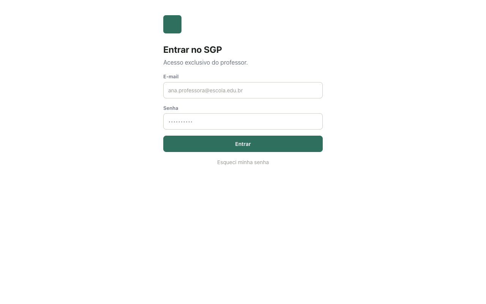

**Login:** entrada exclusiva do professor; o e-mail e a senha são conferidos pela API, que devolve os tokens JWT da sessão.

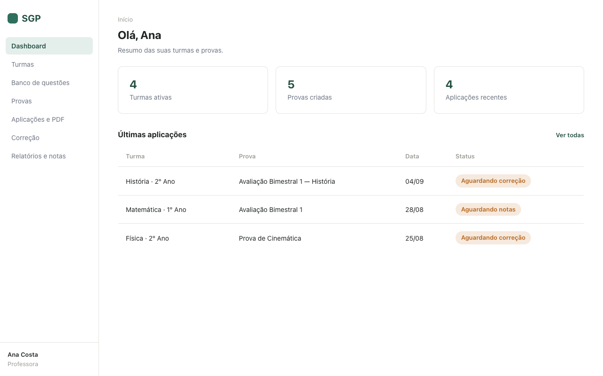

**Dashboard:** resumo com o total de turmas, provas e aplicações, e as últimas aplicações com o status de cada uma.

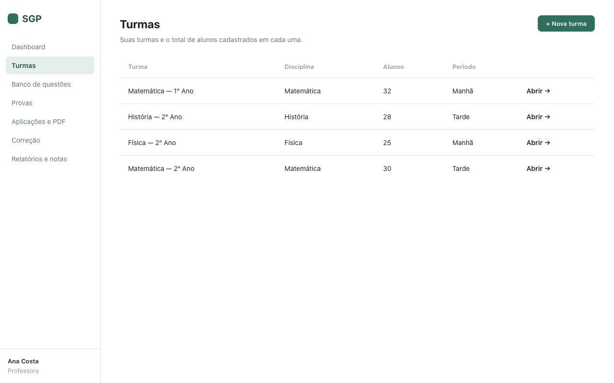

**Turmas:** turmas do professor com disciplina, quantidade de alunos e turno; criar, editar e excluir.

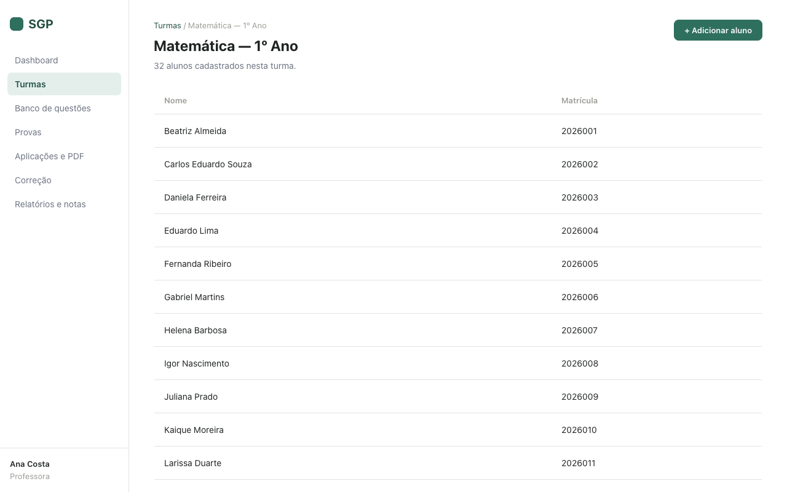

**Detalhe da turma:** alunos cadastrados na turma (nome e matrícula, sem conta de acesso); adicionar, editar e remover aluno.

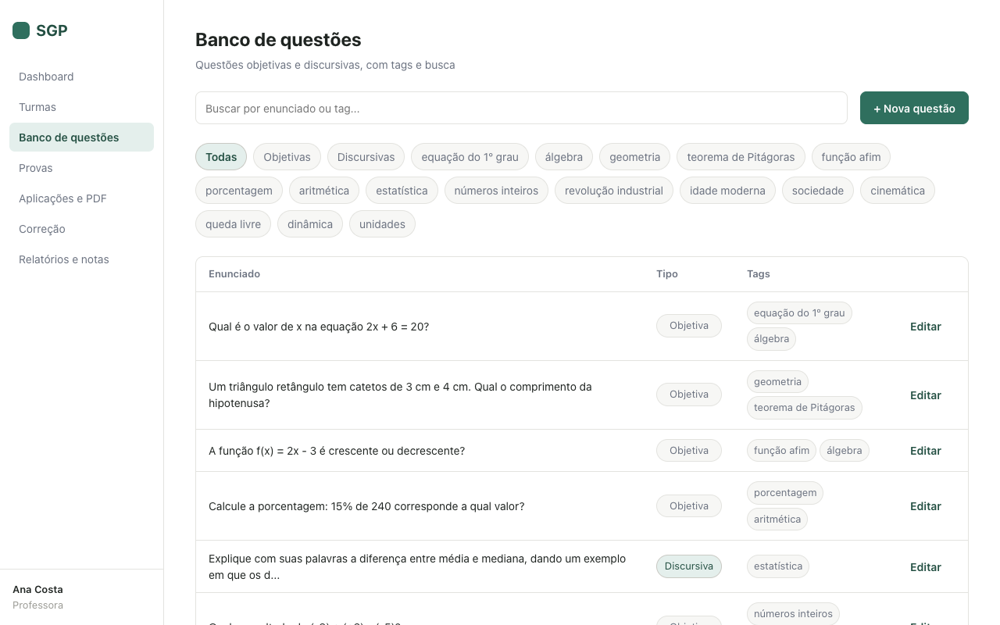

**Banco de questões:** questões objetivas e discursivas, com busca por texto e filtro por tag.

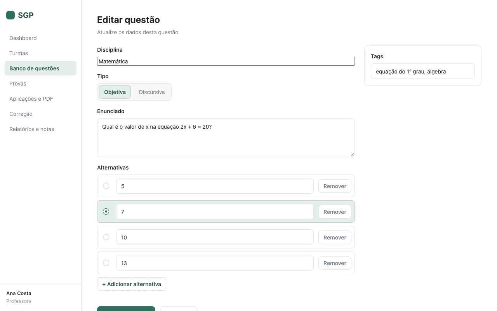

**Editor de questão:** cria ou edita uma questão: tipo, enunciado, tags e alternativas, com a correta marcada.

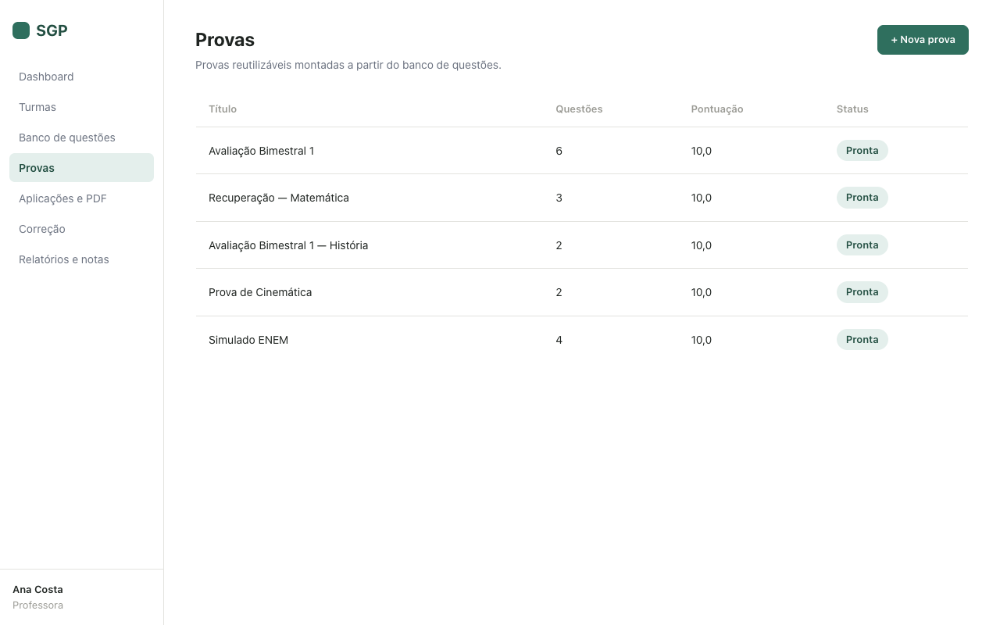

**Provas:** provas reutilizáveis, com a quantidade de questões e a pontuação total; editar e excluir.

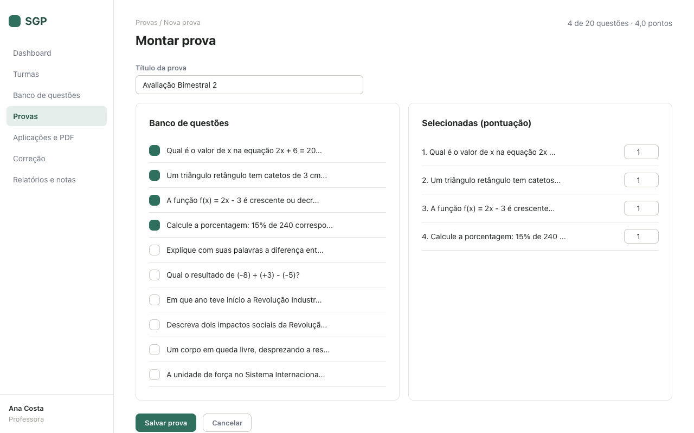

**Montagem de prova:** escolhe até 20 questões do banco e define a pontuação de cada uma.

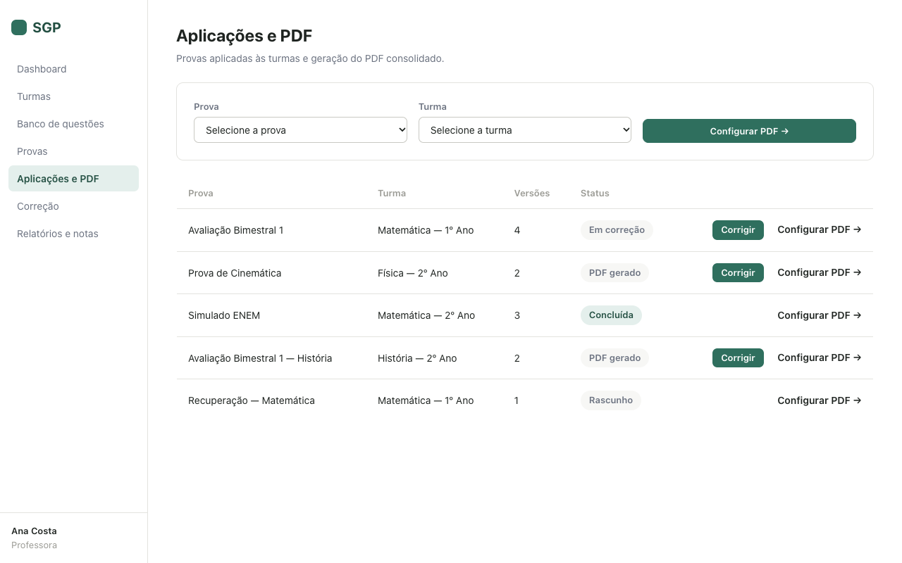

**Aplicações e PDF:** aplica uma prova a uma turma e mostra o status de cada aplicação, com o atalho Corrigir.

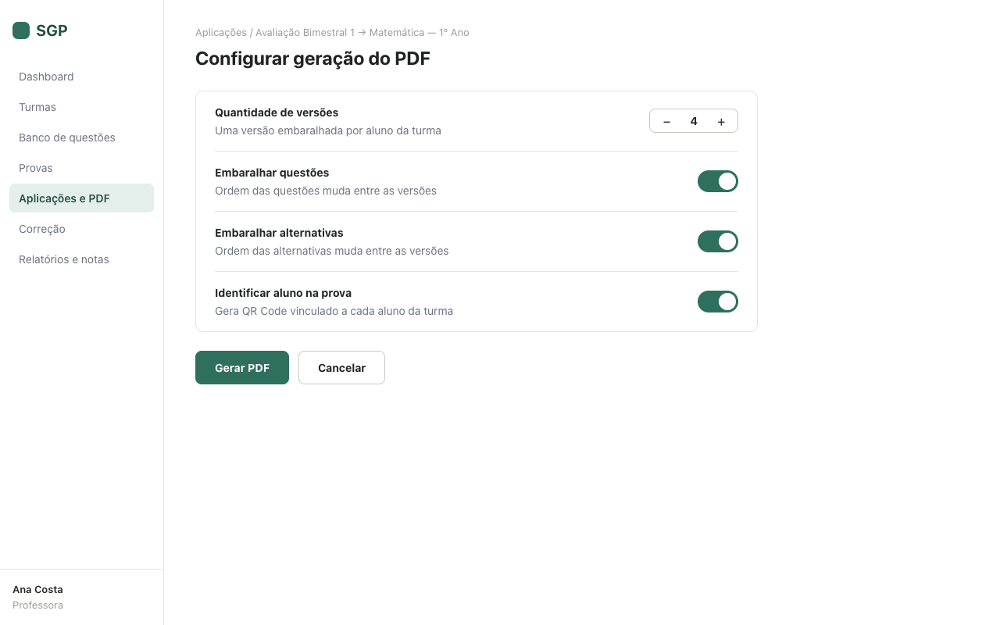

**Gerar versões:** configura versões, embaralhamento de questões e alternativas e identificação do aluno; a API gera as versões e a tela mostra o QR Code de cada uma.

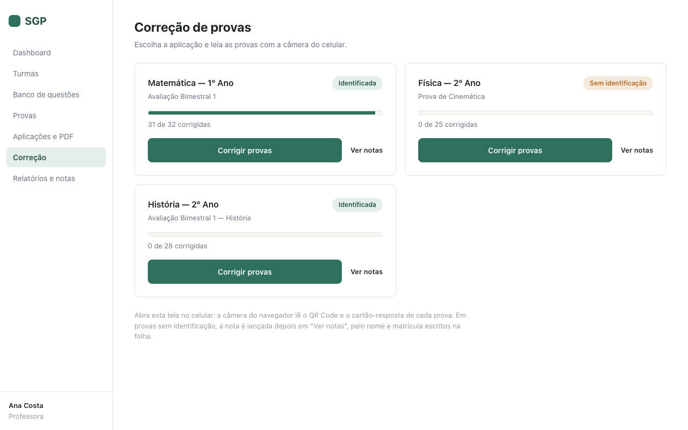

**Correção:** aplicações aguardando correção, com o progresso de provas corrigidas e o acesso à leitura pela câmera.

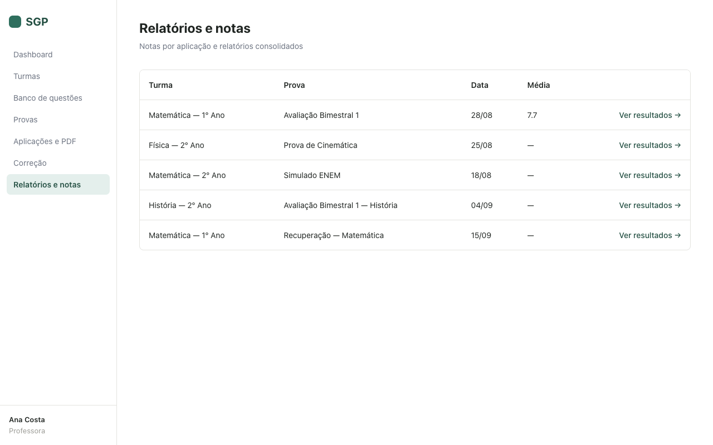

**Relatórios:** aplicações com data e média da turma, com acesso aos resultados de cada uma.

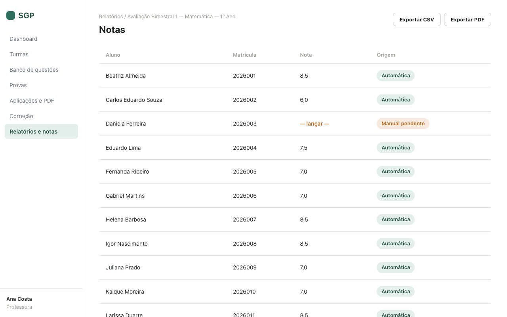

**Notas:** nota de cada aluno com a origem (automática ou manual), estatísticas da turma, lançamento e edição manual de nota e exportação em CSV.

### 4.2 Correção pelo celular

O professor abre o SGP no navegador do celular e corrige as provas pela câmera ([ADR-001](docs/adr/ADR-001-web-responsiva-no-lugar-de-app-nativo.md)).

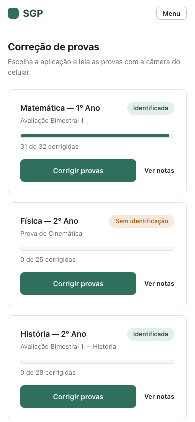

**Correção no celular:** a mesma lista de correção no celular, com o menu recolhido no topo.

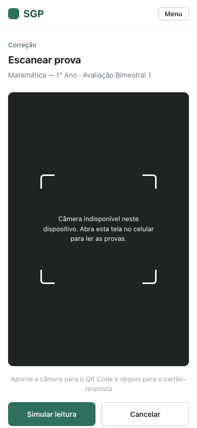

**Escanear prova:** abre a câmera traseira para ler o QR Code e o cartão-resposta; sem câmera, mostra o quadro com a instrução. Nesta fase a leitura ainda é simulada pelo botão **Simular leitura**.

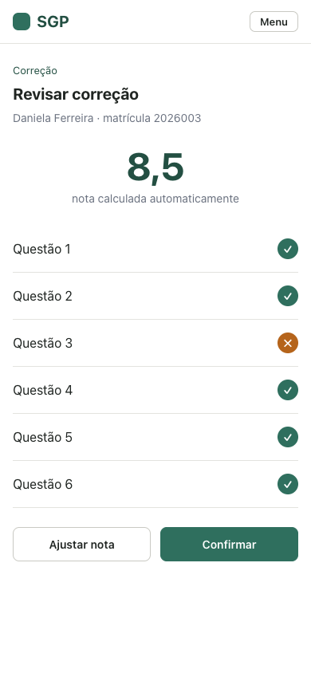

**Revisar correção:** mostra a nota calculada e os acertos por questão para o professor ajustar, se precisar, e confirmar. Confirmar grava a correção no banco, e a API recalcula a nota com o gabarito.

> O print da tela de escanear foi feito em um navegador sem câmera, por isso mostra o quadro escuro com a instrução. No celular, o vídeo da câmera aparece dentro do quadro.

## 5. Modelagem (UML)

Os quatro diagramas partem do mesmo cenário base e seguem o formato do exemplo
dado em aula: cada um tem o passo a passo da análise e o diagrama pronto. O índice
e os responsáveis estão em [`docs/uml/README.md`](docs/uml/README.md).

### 5.1 Caso de Uso


O único ator humano é o **Professor**: o aluno não acessa o sistema e aparece só
como dado da turma. O diagrama reúne o que o professor faz no SGP, do login à
exportação das notas, incluindo a correção pela câmera do celular.
[Passo a passo](docs/uml/01-caso-de-uso/caso-de-uso.md)

### 5.2 Atividade


Fluxo completo de uma prova, do login ao relatório, com raias para o Professor, o
Sistema Web e a web aberta no celular. Mostra as decisões (login inválido, prova
com mais de 20 questões, prova sem identificação) e os laços de leitura das provas.
[Passo a passo](docs/uml/02-atividade/atividade.md)

### 5.3 Classe


As classes do domínio (Professor, Turma, Aluno, Questao, Alternativa, Prova,
ProvaQuestao, Aplicacao, VersaoProva e Correcao), com atributos e
relacionamentos. É a base do modelo de dados da
seção 6. [Passo a passo](docs/uml/03-classe/classe.md)

### 5.4 Sequência


O cenário central do SGP: a correção de uma prova pela câmera do celular, da
leitura do QR Code e do cartão-resposta até a nota guardada na fila local e
sincronizada com a API. [Passo a passo](docs/uml/04-sequencia/sequencia.md)

## 6. Modelo de Dados

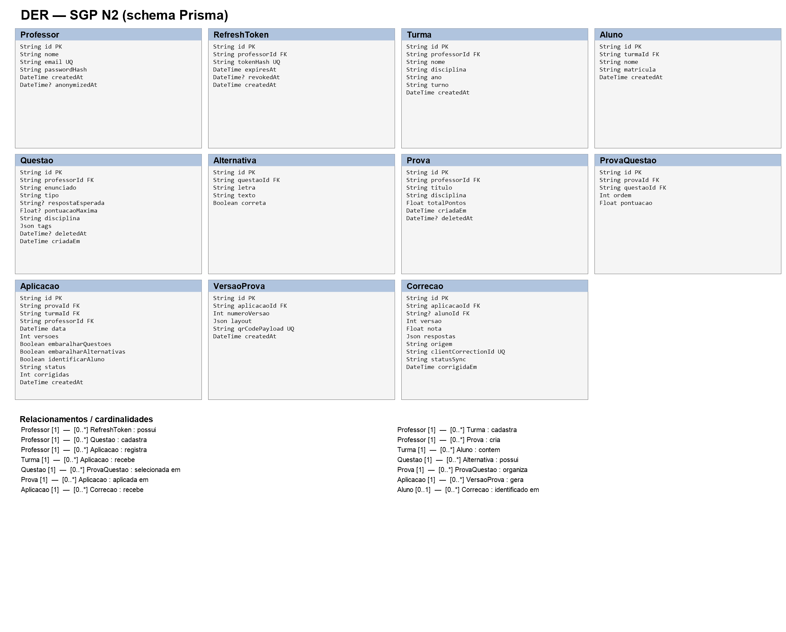

O MER e o DER, com as tabelas, chaves e relacionamentos, estão explicados em
[`docs/modelo-dados/mer-der.md`](docs/modelo-dados/mer-der.md).

A fonte única do modelo é o
[`apps/api/prisma/schema.prisma`](apps/api/prisma/schema.prisma): as migrations,
o seed e os tipos do Prisma Client saem dele, e os diagramas o acompanham.

## 7. Decisões Arquiteturais (ADRs)

Cada decisão de arquitetura fica registrada num ADR, com contexto, alternativas e
consequências. O formato e o índice estão em
[`docs/adr/README.md`](docs/adr/README.md).

| ADR | Decisão | Link |
| --- | --- | --- |
| 001 | Web responsiva no lugar de app nativo: a correção é uma tela da própria web, usada no celular | [ADR-001](docs/adr/ADR-001-web-responsiva-no-lugar-de-app-nativo.md) |
| 002 | MySQL com Prisma 6 na API NestJS, com o `schema.prisma` como fonte única do modelo | [ADR-002](docs/adr/ADR-002-mysql-com-prisma.md) |
| 003 | Autenticação JWT só do professor, com refresh token rotacionado e guard global | [ADR-003](docs/adr/ADR-003-autenticacao-jwt.md) |
| 004 | Hospedagem na Vercel (web e API) com banco MySQL no Aiven | [ADR-004](docs/adr/ADR-004-hospedagem-vercel-e-aiven.md) |
| 005 | Soft-delete de questões, para as provas antigas não perderem a questão | [ADR-005](docs/adr/ADR-005-soft-delete-questao.md) |

## 8. Arquitetura

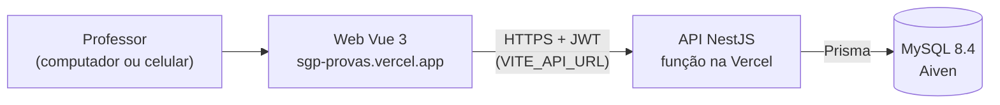

**Camadas da API.** Cada módulo de `apps/api/src/` (auth, classes, questions,
exams, applications, corrections, reports) segue o mesmo caminho:

```
controller  →  service  →  repository  →  Prisma  →  MySQL
(rotas e DTOs)  (regras)    (consultas)
```

O controller recebe a requisição e valida o corpo com os DTOs (class-validator);
o service aplica as regras de negócio; só o repository fala com o banco, pelo
Prisma. As regras que não dependem do banco ficam em arquivos próprios e têm
testes: `validacao-questao.ts`, `regras-prova.ts`, `versoes.ts`,
`calculo-nota.ts` e `estatisticas.ts`.

**Autenticação.** Um guard JWT global protege todas as rotas: rota nova já nasce
exigindo login. As exceções são marcadas com o decorator `@Publica()`: o
`/health` e o cadastro, login e renovação de sessão de `/auth`. O access token
vale 1 hora; o refresh token vale 7 dias, fica no banco só como hash e é trocado a
cada uso ([ADR-003](docs/adr/ADR-003-autenticacao-jwt.md)).

**Isolamento entre professores.** O `professorId` vem sempre do token, nunca do
corpo da requisição, e toda consulta do repository filtra por ele. Pedir um
registro de outro professor responde 404, igual a um registro que não existe.

**Como a web e a API conversam.** A web é uma SPA estática. No build, a URL da API
vem da variável `VITE_API_URL`, e a web chama a API direto. No `npm run dev`, a
web chama `/api` no próprio endereço e o Vite repassa para o `VITE_API_URL`
(`apps/web-professor/vite.config.ts`). Isso é necessário porque a API publicada
só libera o CORS para o endereço de produção da web. Todas as chamadas passam por
`src/services/http.ts`, que envia o token, renova a sessão quando a API responde
401 e devolve para a tela a mensagem de erro da API.

## 9. Especificação da API

Base: https://sgp-provas-api.vercel.app. As rotas abaixo foram conferidas nos
controllers de `apps/api/src/`. Todas usam JSON, menos as que devolvem CSV. As
rotas não públicas exigem o cabeçalho `Authorization: Bearer <accessToken>`.

| Método | Caminho | O que faz | Pública |
| --- | --- | --- | --- |
| GET | `/health` | Confere se a API está no ar | ✅ |
| POST | `/auth/register` | Cadastra um professor e já abre a sessão | ✅ |
| POST | `/auth/login` | Login com e-mail e senha; devolve access token, refresh token e o professor | ✅ |
| POST | `/auth/refresh` | Troca o refresh token por uma sessão nova (o antigo é revogado) | ✅ |
| POST | `/auth/logout` | Revoga o refresh token deste dispositivo | |
| GET | `/auth/me` | Professor logado | |
| GET | `/classes` | Lista as turmas, com os alunos | |
| POST | `/classes` | Cria turma | |
| GET | `/classes/:id` | Uma turma, com os alunos | |
| PATCH | `/classes/:id` | Edita turma | |
| DELETE | `/classes/:id` | Exclui turma (409 se tiver provas corrigidas) | |
| POST | `/classes/:id/students` | Adiciona aluno (409 se a matrícula já existir na turma) | |
| PATCH | `/classes/:id/students/:studentId` | Edita aluno | |
| DELETE | `/classes/:id/students/:studentId` | Remove aluno (409 se tiver prova corrigida) | |
| GET | `/questions` | Lista as questões; filtros opcionais `?busca=` e `?tag=` | |
| POST | `/questions` | Cria questão objetiva ou discursiva | |
| GET | `/questions/:id` | Uma questão | |
| PATCH | `/questions/:id` | Edita questão | |
| DELETE | `/questions/:id` | Exclui questão (soft-delete, [ADR-005](docs/adr/ADR-005-soft-delete-questao.md)) | |
| GET | `/exams` | Lista as provas | |
| POST | `/exams` | Cria prova com 1 a 20 questões e a pontuação de cada uma | |
| GET | `/exams/:id` | Uma prova | |
| PATCH | `/exams/:id` | Edita prova (409 ao trocar as questões de prova com versões geradas) | |
| DELETE | `/exams/:id` | Exclui prova (soft-delete; as aplicações antigas continuam com ela) | |
| GET | `/applications` | Lista as aplicações | |
| POST | `/applications` | Cria aplicação de uma prova para uma turma | |
| GET | `/applications/:id` | Uma aplicação | |
| DELETE | `/applications/:id` | Exclui aplicação (409 se tiver provas corrigidas) | |
| POST | `/applications/:id/generate` | Gera as versões embaralhadas, cada uma com o conteúdo do QR Code | |
| GET | `/applications/:id/corrections` | Correções da aplicação; `?assigned=false` traz só as sem aluno | |
| POST | `/applications/:id/corrections` | Grava uma correção lida pela câmera (a API calcula a nota) ou um lançamento manual; reenviar o mesmo `clientCorrectionId` não duplica | |
| PATCH | `/applications/:id/corrections/:correctionId` | Atribui o aluno e/ou ajusta a nota | |
| GET | `/reports/summary` | Números do dashboard, últimas aplicações e média de cada aplicação | |
| GET | `/reports/consolidated` | CSV com as notas de todas as aplicações (`?format=csv`, o único formato por enquanto) | |
| GET | `/applications/:id/report` | Relatório da aplicação: estatísticas e a nota de cada aluno | |
| GET | `/applications/:id/report.csv` | CSV das notas da aplicação | |

Respostas de erro seguem o formato do NestJS (`{ "statusCode", "message", "error" }`),
com a mensagem em português pronta para a tela.

## 10. Stack Tecnológica


Versões lidas dos `package.json`:

| Parte | Tecnologia |
| --- | --- |
| Runtime | Node.js 22.x (`engines` da API) |
| Web | Vite 8, Vue 3.5 com TypeScript 6, Vue Router 5, Pinia 4 e `qrcode` para a imagem do QR Code |
| API | NestJS 12, Prisma 6.19, `@nestjs/jwt`, `bcryptjs` e class-validator |
| Banco | MySQL 8.4 no Aiven |
| Hospedagem | Vercel: a web como site estático e a API como função serverless |
| Testes | Vitest e Supertest na API; Playwright no teste de ponta a ponta |

Previsto para a N3 e ainda **fora** do código: Redis para cache e filas, object
storage para os PDFs gerados, PWA (service worker e IndexedDB) para a correção
offline e um Vision Service no servidor para conferir a leitura do cartão-resposta.

## 11. Estrutura de Pastas

Monorepo com um pacote por aplicação:

```
apps/
  api/                      # API NestJS
    prisma/
      schema.prisma         # fonte única do modelo de dados
      migrations/           # migrations versionadas
      seed.ts               # dados de demonstração (professora Ana Costa)
    src/
      auth/                 # cadastro, login, refresh e logout (JWT)
      classes/              # turmas e alunos
      questions/            # banco de questões
      exams/                # provas
      applications/         # aplicações e geração das versões
      corrections/          # correções e lançamento manual de nota
      reports/              # resumo, relatório por aplicação e CSVs
      sync/                 # reservado para a sincronização offline (N3)
      common/               # Prisma, guard JWT, decorators e /health
      app.module.ts
      main.ts               # servidor local e handler da Vercel
    test/                   # testes e2e (Supertest)
  web-professor/            # Vite + Vue 3 (TypeScript)
    src/
      pages/                # uma tela por arquivo
      components/           # LogoSGP, EstadoTela, ConfirmarExclusao, QrCode
      layouts/              # AppShell.vue: menu lateral (recolhível no celular) + conteúdo
      router/               # rotas e guarda de login
      services/             # http.ts, sessão e um service por área
      stores/               # auth.ts (Pinia): professor logado
      types/                # tipos no formato que a API devolve
      styles/               # tokens.css: paleta única do sistema
      main.ts
docs/
  adr/                      # decisões arquiteturais
  arquitetura/              # planos da N2
  modelo-dados/             # MER e DER
  telas/                    # protótipos aprovados e prints do sistema
  testes/                   # teste de ponta a ponta da N2, com prints
  uml/                      # caso de uso, atividade, classe e sequência
```

## 12. Como rodar o projeto

Pré-requisitos: **Node.js 22.x** e um **MySQL 8.4** (o do Aiven ou um local). Cada
app tem suas próprias dependências; `node_modules/` e `.env` não vão para o Git.

### API (http://localhost:3000)

```bash
cd apps/api
npm install --legacy-peer-deps
cp .env.example .env        # preencha DATABASE_URL, JWT_SECRET, JWT_REFRESH_SECRET e WEB_ORIGIN
npx prisma migrate deploy   # cria as tabelas
npx prisma db seed          # dados de demonstração (Ana Costa)
npm run start:dev           # http://localhost:3000/health
npm test                    # testes unitários
npm run test:e2e            # testes e2e
```

O `.env.example` explica o formato de cada variável. O `--legacy-peer-deps` é
necessário só na API: o npm 10.9.x quebra ao resolver os peers opcionais do
vitest 4, e o flag contorna o bug sem alterar versão nenhuma.

### Web (http://localhost:5173)

```bash
cd apps/web-professor
npm install
cp .env.example .env        # VITE_API_URL: a API publicada ou http://localhost:3000
npm run dev
```

No `npm run dev`, a web chama `/api` e o Vite repassa para o `VITE_API_URL`
(seção 8). Para testar a correção no celular, abra a web no navegador do aparelho.
A câmera só abre em contexto seguro (HTTPS ou `localhost`), então use o link
publicado. Sem câmera, a tela mostra o quadro com a instrução e o botão
**Simular leitura** continua funcionando.

Antes de mexer em qualquer tela, leia o [CONTRIBUTING.md](CONTRIBUTING.md): ele
traz a convenção de commit e o fluxo de branch e PR.

## 13. Sistema hospedado

| | |
| --- | --- |
| **Web** | https://sgp-provas.vercel.app |
| **API** | https://sgp-provas-api.vercel.app/health |
| **Conta de demonstração** | `ana.costa@escola.edu.br` / `sgp2026` |

A conta de demonstração vem do seed: a professora Ana Costa, com 4 turmas, 115
alunos, 10 questões, 5 provas e 5 aplicações.

> **Primeiro acesso pode demorar.** O banco está no plano gratuito do Aiven e a API
> é uma função serverless: depois de um tempo sem uso, a primeira requisição pode
> levar alguns segundos enquanto tudo acorda. Se o login demorar, espere e tente de
> novo.

## 14. Deploy

São dois projetos na Vercel, ligados ao repositório. Cada push na `main` publica
os dois; cada pull request ganha uma URL de preview.

| | Web | API |
| --- | --- | --- |
| Projeto Vercel | `sgp-provas` | `sgp-provas-api` |
| Root Directory | `apps/web-professor` | `apps/api` |
| Framework Preset | Vite | NestJS |
| Node | 22.x | 22.x |
| Variáveis de ambiente | `VITE_API_URL` | `DATABASE_URL`, `JWT_SECRET`, `JWT_REFRESH_SECRET`, `WEB_ORIGIN` |

- **Web:** o build gera o site estático em `dist`. O
  `apps/web-professor/vercel.json` redireciona todas as rotas para o `index.html`,
  para que recarregar a página numa rota interna (ex.: `/turmas`) não dê 404.
- **API:** roda como função serverless. O `npm install` roda o `prisma generate`
  (`postinstall`), e o `schema.prisma` inclui os motores do Prisma para o Linux da
  Vercel. O app Nest é criado na primeira requisição e reaproveitado nas seguintes.
- **Migrations:** não rodam no build. Quando o schema muda, aplique com
  `npx prisma migrate deploy` apontando para o banco de produção.
- **Segredos:** os valores das variáveis ficam só na Vercel (marcados como
  sensíveis) e no `.env` local de quem roda a API, nunca no repositório.

## 15. Testes

### Teste de ponta a ponta no sistema publicado

Os 13 passos do fluxo do professor foram executados no site publicado com o
Playwright: login, CRUD de turmas, alunos, questões e provas, aplicação com
versões, correção no celular, nota manual, relatório com CSV, mensagens 409 da
API, recarregar rota interna e sair. Dois problemas encontrados (imagem do QR
Code e nome do CSV) foram corrigidos e o teste repetido: **13 de 13**. O registro
completo, com um print de cada passo, está em
[`docs/testes/n2-ponta-a-ponta.md`](docs/testes/n2-ponta-a-ponta.md).

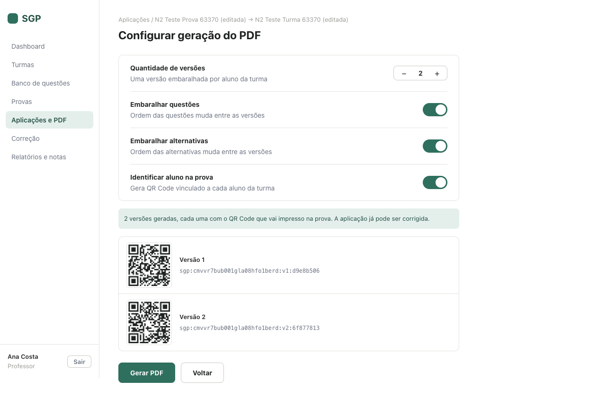

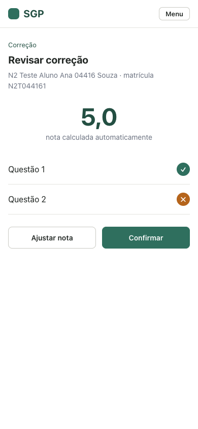

### Testes automatizados da API

```bash
cd apps/api
npm test           # 27 testes unitários em 5 arquivos
npm run test:e2e   # 3 testes e2e em 2 arquivos
```

- **Unitários** (Vitest): as regras de negócio sem banco: validação de questão e
  limite de questões por prova, embaralhamento das versões, cálculo da nota e
  estatísticas (média, mediana e desvio padrão).
- **E2E** (Vitest e Supertest): o `/health` e a rota do relatório consolidado em
  CSV, com o repositório trocado por um falso.

## 16. Estado atual (N2)

**Integrado ao banco e funcionando no sistema publicado:**

| Item | Situação |
| --- | --- |
| Login real com JWT (access e refresh token) e logout | ✅ |
| CRUD de turmas e alunos | ✅ |
| CRUD de questões (objetivas e discursivas, com soft-delete) | ✅ |
| CRUD de provas (até 20 questões, pontuação por questão) | ✅ |
| Aplicações com geração de versões embaralhadas e QR Code | ✅ |
| Correção pela tela do celular gravando a nota no banco | ✅ (leitura simulada) |
| Lançamento e edição manual de nota, atribuição de prova sem identificação | ✅ |
| Relatórios com média, mediana e desvio padrão | ✅ |
| CSV das notas por aplicação | ✅ |
| CSV consolidado de todas as aplicações | ✅ na API (`GET /reports/consolidated`) |
| Nenhuma tela com dado fixo | ✅ (`grep -rni "mock" apps/web-professor/src` vazio) |

**Fica para a N3:**

- PDF real da prova, com as versões e o QR Code impressos.
- Leitura real do QR Code e do cartão-resposta pela câmera.
- Funcionamento offline da correção (PWA, fila local e sincronização).
- Status "Concluída" automático quando todas as provas da aplicação forem corrigidas.
- Rate limit no login contra força bruta (RNF04).
- Exportação dos relatórios em xlsx e PDF.
- Conexão com o banco verificando o certificado (CA) do Aiven.
- Resolver os avisos do `npm audit` nas dependências de desenvolvimento.

Regras que continuam valendo para todo mundo:

- **Não invente cor:** use só as variáveis de `apps/web-professor/src/styles/tokens.css`.
- **Nenhum dado fixo nas telas:** tudo vem da API, pelos services de `src/services/`.
- **O aluno não acessa o sistema:** nunca crie campo de e-mail, senha ou login para aluno.
- **Segredos fora do Git:** nunca commite `.env`, `.vercel/`, senha ou URL do banco.

---

<div align="center">

_README elaborado para a disciplina de Projeto e Arquitetura de Software — Grupo 10_

</div>
