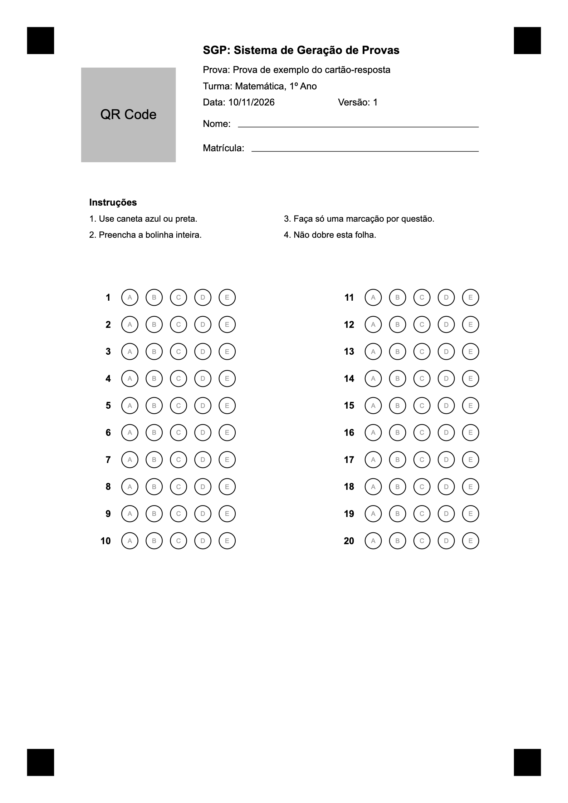
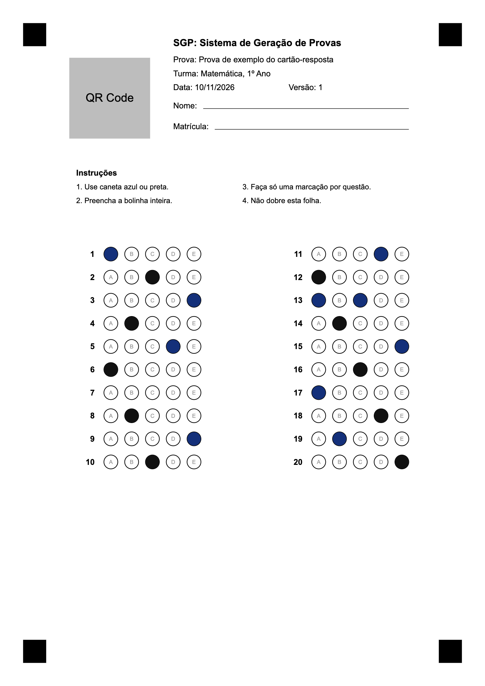

# Layout do cartão-resposta

Este documento é o contrato entre quem imprime e quem lê o cartão-resposta do SGP:
o PDF da aplicação (T03, #49) desenha o cartão exatamente nestas medidas, e a leitura
pela câmera (T07, #50 e T08, #65) procura as bolinhas exatamente nestas posições. Se
uma medida mudar aqui, os dois lados precisam mudar juntos.

Todas as medidas estão em **milímetros**, com a origem no **canto superior esquerdo
da folha**: x cresce para a direita e y cresce para baixo. Quando a medida é de um
quadrado, (x, y) é o canto superior esquerdo. Quando é de uma bolinha, (x, y) é o
centro.

Exemplos prontos para imprimir: [`cartao-resposta-exemplo.svg`](cartao-resposta-exemplo.svg)
e [`cartao-resposta-exemplo-preenchido.svg`](cartao-resposta-exemplo-preenchido.svg).



## 1. Resumo das medidas

| Item | Medida |
|---|---|
| Folha | A4 em retrato, 210 x 297 mm, uma por aluno ou versão |
| Marcas de alinhamento | 4 quadrados pretos cheios de 10 x 10 mm, canto externo a 10 mm das bordas |
| QR Code | 35 x 35 mm em (30, 25), correção de erro nível M |
| Cabeçalho | x de 75 a 177, y de 15 a 60 |
| Instruções | x de 33 a 180, y de 72 a 89 |
| Grade | 20 questões em 2 colunas de 10, y dos centros de 110 a 200 |
| Bolinha | diâmetro de 6 mm, 9 mm entre centros na horizontal, 10 mm na vertical |
| Área livre | 10 mm em volta das marcas e do QR Code |

## 2. Decisões que mudaram o ponto de partida

- **O QR Code foi de (25, 25) para (30, 25).** A marca superior esquerda termina em
  (20, 20). Com o QR em x = 25, sobravam só 5 mm entre os dois, e a área livre de
  10 mm não cabia. Em x = 30 a distância horizontal é de exatos 10 mm.
- **A letra é impressa dentro da bolinha,** em cinza claro. Sem isso, o aluno da
  questão 10 teria que voltar 90 mm na folha para saber qual coluna é a C. A letra
  não atrapalha a leitura: ocupa de 5% a 7% da área medida, muito abaixo dos 50%
  da regra (medido com Arial em cada letra, de A a E).
- **O cabeçalho começa em x = 75,** o primeiro ponto fora da área livre do QR Code.

## 3. Marcas de alinhamento

Quadrados pretos cheios (`#000`) de 10 x 10 mm.

| Marca | x | y | Centro (x, y) |
|---|---:|---:|---:|
| Superior esquerda | 10 | 10 | (15, 15) |
| Superior direita | 190 | 10 | (195, 15) |
| Inferior esquerda | 10 | 277 | (15, 282) |
| Inferior direita | 190 | 277 | (195, 282) |

A leitura usa os **centros** das marcas. Eles formam um retângulo de 180 x 267 mm.

## 4. QR Code

- **Posição:** 35 x 35 mm em (30, 25), até (65, 60). Os 35 mm são só os módulos, sem
  margem na imagem: a área livre em volta já faz esse papel.
- **Correção de erro:** nível M, preto puro sobre branco.
- **Tamanho do conteúdo:** com ids cuid de 25 caracteres, o payload tem até 43
  caracteres na prova comum e até 70 na identificada. Isso cabe na versão 5 do QR
  Code (37 módulos), com cerca de 0,95 mm por módulo.

| Prova | Payload |
|---|---|
| Sem identificação (hoje) | `sgp:<aplicacaoId>:v<numeroVersao>:<hash>` |
| Identificada (reservado para a T04, #63) | `sgp:<aplicacaoId>:v<numeroVersao>:<hash>:a<alunoId>` |

O `<hash>` são 8 caracteres hexadecimais. As versões criadas pelo seed não têm hash
(`sgp:aplicacao-1:v1`), então o leitor precisa aceitar as três formas:

```
^sgp:([^:]+):v(\d+)(?::([0-9a-f]{8}))?(?::a([^:]+))?$
```

## 5. Cabeçalho

Fica à direita do QR Code, de x = 75 a x = 177. Texto em preto, Arial ou Helvetica.

| Campo | x | y (linha de base) | Altura da fonte |
|---|---:|---:|---:|
| Nome do sistema, em negrito | 75 | 20 | 4,2 |
| Prova | 75 | 27 | 3,5 |
| Turma | 75 | 33 | 3,5 |
| Data | 75 | 39 | 3,5 |
| Versão | 125 | 39 | 3,5 |
| Nome | 75 | 47 | 3,5 |
| Matrícula | 75 | 56 | 3,5 |

- **Prova identificada:** o nome e a matrícula saem impressos depois do rótulo.
- **Prova sem identificação:** linhas em branco para o aluno escrever, de x = 88 a
  177 (nome) e de x = 93 a 177 (matrícula), com traço de 0,2 mm.
- **Texto longo:** o título da prova pode ter até 150 caracteres e o nome da turma
  e do aluno, até 120. Nessa fonte cabem cerca de 60 caracteres, então o texto é
  cortado com reticências em x = 177. Ele nunca quebra de linha nem passa dessa
  posição.

## 6. Instruções

Título em negrito, altura 3,5, em (33, 76). Os itens têm altura 3,2:

| Item | x | y |
|---|---:|---:|
| 1. Use caneta azul ou preta. | 33 | 82 |
| 2. Preencha a bolinha inteira. | 33 | 88 |
| 3. Faça só uma marcação por questão. | 105 | 82 |
| 4. Não dobre esta folha. | 105 | 88 |

## 7. Grade de respostas

São até 20 questões em 2 colunas de 10: questões 1 a 10 na coluna 1 e 11 a 20 na
coluna 2. As posições são fixas: uma prova com 12 questões usa as linhas 1 a 12 e
deixa o resto da grade em branco.

- **Bolinha A da questão 1:** (48, 110) na coluna 1.
- **Bolinha A da questão 11:** (138, 110) na coluna 2.

Para a questão `q` (1 a 20) e a alternativa de índice `i` (A = 0, B = 1, C = 2,
D = 3, E = 4):

```
x0 = 48 se q <= 10, 138 se q > 10
x  = x0 + 9 * i
y  = 110 + 10 * ((q - 1) % 10)
```

- **Bolinha:** círculo de raio 3 mm, fundo branco, contorno preto de 0,3 mm.
- **Letra dentro da bolinha:** centralizada, altura 2,4, cinza `#999`, com a linha de
  base em `y + 0,85`.
- **Número da questão:** em negrito, altura 3,5, alinhado à direita em `x0 - 7`, com
  a linha de base em `y + 1,2`.

Casos que mudam a linha:

- **Menos de 5 alternativas:** imprime só as bolinhas que existem, a partir de A. A
  posição de cada letra não muda: uma questão com 3 alternativas usa A, B e C.
- **Questão discursiva:** a linha traz o número e o texto
  "Discursiva: corrigida pelo professor", sem bolinhas, altura 2,5, começando em
  `x0 - 3`, com a linha de base em `y + 1`. O texto mede 39 mm e cabe no espaço das
  bolinhas. A pontuação é dada na tela de revisão.

## 8. Ordem das questões e letras

O cartão segue a **ordem da versão**, e as letras são as **da versão**, como no
caderno que o aluno recebeu. A linha `q` da grade é a questão com `ordem = q` no
`layout` da `VersaoProva`.

A API espera a letra **original** em `marcada`, porque calcula a nota com o gabarito
do banco (`calculo-nota.ts`). A conversão é feita na tela, antes de enviar:

```
questao       = layout.questoes[q - 1]
questaoId     = questao.questaoId
letraOriginal = questao.alternativas[i]
```

Por exemplo, se `alternativas` for `['C', 'A', 'B']`, a bolinha impressa como A (i = 0)
é a alternativa original C.

> **Pendência para a T07/T08:** hoje nenhuma rota da API devolve o `layout`, só o
> `POST /applications/:id/generate` devolve `numeroVersao` e `qrCodePayload`. A leitura
> precisa de uma rota nova com o layout da versão para fazer essa conversão.

## 9. Área livre

Nada pode ser impresso a menos de 10 mm das marcas e do QR Code. As faixas abaixo são
as áreas proibidas, já contando a própria marca ou o QR Code:

| Área | x | y |
|---|---:|---:|
| Marca superior esquerda | 0 a 30 | 0 a 30 |
| Marca superior direita | 180 a 210 | 0 a 30 |
| Marca inferior esquerda | 0 a 30 | 267 a 297 |
| Marca inferior direita | 180 a 210 | 267 a 297 |
| QR Code | 20 a 75 | 15 a 70 |

O espaço entre a grade e as marcas de baixo (y de 204 a 267) também fica em branco.

## 10. Regras de leitura

Para cada linha da grade, a leitura calcula o **preenchimento** de cada bolinha que
existe: a fração de pixels escuros dentro do círculo de medida (seção 12). Depois
aplica estas regras, em ordem:

| Situação na linha | Resultado | `marcada` | Sinalização na revisão |
|---|---|---:|---|
| Nenhuma bolinha com 50% ou mais | Em branco | `null` | Em branco |
| Uma bolinha com 50% ou mais, e pelo menos 20 pontos acima da segunda mais escura | Marcada | letra original | Nenhuma |
| Duas ou mais com 50% ou mais, sem uma 20 pontos acima das outras | Anulada | `null` | Revisar: mais de uma marcação |
| Uma com 50% ou mais, mas menos de 20 pontos acima da segunda | Anulada | `null` | Revisar: marcação duvidosa |

"Claramente a mais escura" quer dizer esses 20 pontos percentuais de diferença. Assim,
uma bolinha rabiscada e apagada ao lado da resposta (60% contra 95%) não anula a
questão, mas duas bolinhas pintadas (90% contra 95%) anulam.

Questão anulada e questão em branco valem 0 ponto. A sinalização existe só na tela de
revisão, onde o professor pode corrigir a leitura antes de confirmar: a API recebe
`null` nos dois casos.

### Tolerâncias

Estes são os valores de partida da T08. Ainda não foram medidos em fotos reais: se o
teste com cartões impressos mostrar outros limites, atualize esta tabela.

| Situação | Tolerância | Fora disso |
|---|---|---|
| Foto torta (giro no plano da folha) | até 15 graus | Pedir nova foto |
| Inclinação da câmera em relação à folha | até 25 graus | Pedir nova foto |
| Resolução | folha com pelo menos 1200 px de altura na foto | Pedir para aproximar |
| Enquadramento | as 4 marcas inteiras na imagem | Pedir nova foto |
| Forma do retângulo das marcas | largura/altura depois de retificar em 0,674, com 3% de erro | Marcas erradas: pedir nova foto |
| Iluminação | sombra suave aceita, porque o branco é medido bolinha a bolinha | Sem contraste entre marca e papel: pedir mais luz |
| Folha de cabeça para baixo | aceita: o QR Code indica o lado certo | |
| Desvio da bolinha depois de retificar | até 0,6 mm sem ajuste | Procurar o contorno a até 1,5 mm do centro esperado |

## 11. Como o PDF deve imprimir

- Página A4 em retrato (595,28 x 841,89 pt). Para converter: 1 mm = 2,8346 pt.
- O cartão é desenhado em **escala 100%**. O PDF não usa "ajustar à página" e a
  impressão também não deve usar: o manual do usuário (T28) precisa avisar isso.
- As marcas são retângulos vetoriais em preto puro, nunca imagem redimensionada.
- O QR Code é gerado com margem 0 e colocado em exatos 35 x 35 mm, sem suavização.
- Cada aluno ou versão recebe um cartão em folha própria, depois do caderno.
- Nada além do que está neste documento vai na folha do cartão: nem número de
  página, nem rodapé.

## 12. Como a leitura deve medir

1. **Achar as marcas.** Binarizar a foto e procurar, em cada quadrante, a maior região
   preta quadrada e cheia. O centro dela é o ponto de referência.
2. **Corrigir a perspectiva.** Calcular a homografia entre os 4 centros na foto e os
   centros em mm da seção 3, e gerar a imagem retificada a **4 pixels por mm**
   (840 x 1188 pixels). A partir daí, `px = mm * 4`.
3. **Conferir o lado.** Ler o QR Code. Se ele não estiver na região de (30, 25) a
   (65, 60), girar a imagem 180 graus.
4. **Definir os níveis de preto e branco.** O preto `P` é a mediana da luminosidade das
   4 marcas. O branco `B` de cada bolinha é a mediana do anel entre 3,5 e 4,3 mm do
   centro dela, que fica fora do contorno e não alcança a bolinha vizinha.
5. **Medir o preenchimento.** Dentro de um círculo de raio **2,4 mm**, para não contar
   o contorno, um pixel é escuro quando a luminosidade é menor que `(P + B) / 2`. O
   preenchimento é a fração de pixels escuros. Esse corte separa a tinta azul ou preta
   do papel e deixa de fora a letra cinza impressa.
6. **Aplicar as regras** da seção 10, só nas bolinhas que existem na questão: o número
   de alternativas vem do `layout`. Questão discursiva não é medida.

A leitura roda toda no navegador, sem servidor, para funcionar offline (T11, #51).

## 13. Tabela de coordenadas

Centro de cada bolinha, em mm. O raio é de 3 mm em todas.

| Questão | Coluna | y | x de A | x de B | x de C | x de D | x de E |
|---:|---:|---:|---:|---:|---:|---:|---:|
| 1 | 1 | 110 | 48 | 57 | 66 | 75 | 84 |
| 2 | 1 | 120 | 48 | 57 | 66 | 75 | 84 |
| 3 | 1 | 130 | 48 | 57 | 66 | 75 | 84 |
| 4 | 1 | 140 | 48 | 57 | 66 | 75 | 84 |
| 5 | 1 | 150 | 48 | 57 | 66 | 75 | 84 |
| 6 | 1 | 160 | 48 | 57 | 66 | 75 | 84 |
| 7 | 1 | 170 | 48 | 57 | 66 | 75 | 84 |
| 8 | 1 | 180 | 48 | 57 | 66 | 75 | 84 |
| 9 | 1 | 190 | 48 | 57 | 66 | 75 | 84 |
| 10 | 1 | 200 | 48 | 57 | 66 | 75 | 84 |
| 11 | 2 | 110 | 138 | 147 | 156 | 165 | 174 |
| 12 | 2 | 120 | 138 | 147 | 156 | 165 | 174 |
| 13 | 2 | 130 | 138 | 147 | 156 | 165 | 174 |
| 14 | 2 | 140 | 138 | 147 | 156 | 165 | 174 |
| 15 | 2 | 150 | 138 | 147 | 156 | 165 | 174 |
| 16 | 2 | 160 | 138 | 147 | 156 | 165 | 174 |
| 17 | 2 | 170 | 138 | 147 | 156 | 165 | 174 |
| 18 | 2 | 180 | 138 | 147 | 156 | 165 | 174 |
| 19 | 2 | 190 | 138 | 147 | 156 | 165 | 174 |
| 20 | 2 | 200 | 138 | 147 | 156 | 165 | 174 |

## 14. Exemplos para testar

| Arquivo | Conteúdo |
|---|---|
| [`cartao-resposta-exemplo.svg`](cartao-resposta-exemplo.svg) | Cartão em branco, com 20 questões objetivas de 5 alternativas |
| [`cartao-resposta-exemplo-preenchido.svg`](cartao-resposta-exemplo-preenchido.svg) | O mesmo cartão com as marcações abaixo, em azul e preto |

**Para imprimir:** abra o SVG no Chrome, escolha Imprimir e use **Margens: nenhuma** e
**Escala: 100%**. Depois meça com a régua: o lado da marca deve dar 10 mm, e a
distância entre as bordas externas das marcas de cima, 190 mm.

No lugar do QR Code há um quadrado cinza, porque o exemplo ainda não pertence a uma
aplicação. Por isso ele serve para testar as marcas e as bolinhas, mas não a etapa 3
da seção 12.



Resultado esperado da leitura do exemplo preenchido:

| Questão | 1 | 2 | 3 | 4 | 5 | 6 | 7 | 8 | 9 | 10 |
|---|---|---|---|---|---|---|---|---|---|---|
| Lida | A | C | E | B | D | A | em branco | B | E | C |

| Questão | 11 | 12 | 13 | 14 | 15 | 16 | 17 | 18 | 19 | 20 |
|---|---|---|---|---|---|---|---|---|---|---|
| Lida | D | A | anulada (A e C) | B | E | C | A | D | B | E |
