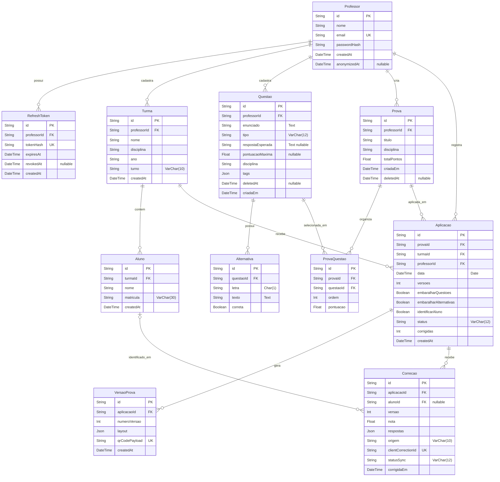

# Modelo de dados — SGP N2

O diagrama abaixo reproduz os 12 modelos de `apps/api/prisma/schema.prisma`. `PK` indica chave primária; `FK` indica chave estrangeira. Os tipos são os escalares Prisma, incluindo modificadores MySQL definidos com `@db.*`. `?` indica campo anulável. As cardinalidades mostram quantos registros podem existir em cada lado conforme nulabilidade e relações do schema.

## Dicionário de dados

`Obrigatório` descreve se a coluna aceita `NULL`; valores padrão definidos no schema são indicados na descrição. Tipos apresentados como `String`, `Float` etc. são escalares Prisma; os tipos nativos MySQL aparecem entre parênteses.

### Professor

| Campo | Tipo | Obrigatório | Descrição |
|---|---|---:|---|
| id | String | Sim | Identificador textual, chave primária, gerado por `cuid()`. |
| nome | String | Sim | Nome do professor. |
| email | String | Sim | E-mail de login, único. |
| passwordHash | String | Sim | Hash da senha. |
| createdAt | DateTime | Sim | Criação, padrão `now()`. |
| anonymizedAt | DateTime | Não | Data de anonimização da conta. |

### RefreshToken

| Campo | Tipo | Obrigatório | Descrição |
|---|---|---:|---|
| id | String | Sim | Chave primária textual, `cuid()`. |
| professorId | String | Sim | FK para `Professor.id`; indexada. |
| tokenHash | String | Sim | Hash SHA-256, único. |
| expiresAt | DateTime | Sim | Data de expiração do token. |
| revokedAt | DateTime | Não | Data de revogação, se revogado. |
| createdAt | DateTime | Sim | Criação, padrão `now()`. |

### Turma

| Campo | Tipo | Obrigatório | Descrição |
|---|---|---:|---|
| id | String | Sim | Chave primária textual, `cuid()`. |
| professorId | String | Sim | FK para `Professor.id`; indexada. |
| nome | String | Sim | Nome da turma. |
| disciplina | String | Sim | Disciplina da turma. |
| ano | String | Sim | Ano letivo. |
| turno | String (`VarChar(10)`) | Sim | Turno; valores aceitos são validados pela API. |
| createdAt | DateTime | Sim | Criação, padrão `now()`. |

### Aluno

| Campo | Tipo | Obrigatório | Descrição |
|---|---|---:|---|
| id | String | Sim | Chave primária textual, `cuid()`. |
| turmaId | String | Sim | FK para `Turma.id`. |
| nome | String | Sim | Nome do aluno. |
| matricula | String (`VarChar(30)`) | Sim | Matrícula, única dentro da turma junto com `turmaId`. |
| createdAt | DateTime | Sim | Criação, padrão `now()`. |

### Questao

| Campo | Tipo | Obrigatório | Descrição |
|---|---|---:|---|
| id | String | Sim | Chave primária textual, `cuid()`. |
| professorId | String | Sim | FK para `Professor.id`; indexada. |
| enunciado | String (`Text`) | Sim | Enunciado da questão. |
| tipo | String (`VarChar(12)`) | Sim | Tipo da questão, validado pela API. |
| respostaEsperada | String (`Text`) | Não | Resposta esperada, quando aplicável. |
| pontuacaoMaxima | Float | Não | Pontuação máxima, quando informada. |
| disciplina | String | Sim | Disciplina da questão. |
| tags | Json | Sim | Lista de textos para classificação. |
| deletedAt | DateTime | Não | Data de exclusão lógica; mantém referências existentes. |
| criadaEm | DateTime | Sim | Criação, padrão `now()`. |

### Alternativa

| Campo | Tipo | Obrigatório | Descrição |
|---|---|---:|---|
| id | String | Sim | Chave primária textual, `cuid()`. |
| questaoId | String | Sim | FK para `Questao.id`. |
| letra | String (`Char(1)`) | Sim | Identificador de alternativa; único por questão. |
| texto | String (`Text`) | Sim | Texto da alternativa. |
| correta | Boolean | Sim | Indica se é a alternativa correta. |

### Prova

| Campo | Tipo | Obrigatório | Descrição |
|---|---|---:|---|
| id | String | Sim | Chave primária textual, `cuid()`. |
| professorId | String | Sim | FK para `Professor.id`; indexada. |
| titulo | String | Sim | Título da prova. |
| disciplina | String | Sim | Disciplina da prova. |
| totalPontos | Float | Sim | Soma dos pontos, calculada pela API. |
| criadaEm | DateTime | Sim | Criação, padrão `now()`. |
| deletedAt | DateTime | Não | Data de exclusão lógica; preserva aplicações existentes. |

### ProvaQuestao

| Campo | Tipo | Obrigatório | Descrição |
|---|---|---:|---|
| id | String | Sim | Chave primária textual, `cuid()`. |
| provaId | String | Sim | FK para `Prova.id`; único em conjunto com `questaoId`. |
| questaoId | String | Sim | FK para `Questao.id`; único em conjunto com `provaId`. |
| ordem | Int | Sim | Posição da questão na prova. |
| pontuacao | Float | Sim | Pontuação atribuída à questão nesta prova. |

### Aplicacao

| Campo | Tipo | Obrigatório | Descrição |
|---|---|---:|---|
| id | String | Sim | Chave primária textual, `cuid()`. |
| provaId | String | Sim | FK para `Prova.id`. |
| turmaId | String | Sim | FK para `Turma.id`; indexada. |
| professorId | String | Sim | FK para `Professor.id`; indexada. |
| data | DateTime (`Date`) | Sim | Data prevista para aplicação, sem horário. |
| versoes | Int | Sim | Quantidade de versões. |
| embaralharQuestoes | Boolean | Sim | Se a ordem das questões será embaralhada. |
| embaralharAlternativas | Boolean | Sim | Se a ordem das alternativas será embaralhada. |
| identificarAluno | Boolean | Sim | Se a prova solicita identificação do aluno. |
| status | String (`VarChar(12)`) | Sim | Estado da aplicação; padrão `rascunho`, validado pela API. |
| corrigidas | Int | Sim | Contador de provas corrigidas; padrão `0`. |
| createdAt | DateTime | Sim | Criação, padrão `now()`. |

### VersaoProva

| Campo | Tipo | Obrigatório | Descrição |
|---|---|---:|---|
| id | String | Sim | Chave primária textual, `cuid()`. |
| aplicacaoId | String | Sim | FK para `Aplicacao.id`; único com `numeroVersao`. |
| numeroVersao | Int | Sim | Número da versão na aplicação. |
| layout | Json | Sim | Ordem de questões e alternativas nesta versão. |
| qrCodePayload | String | Sim | Conteúdo do QR Code, único. |
| createdAt | DateTime | Sim | Criação, padrão `now()`. |

### Correcao

| Campo | Tipo | Obrigatório | Descrição |
|---|---|---:|---|
| id | String | Sim | Chave primária textual, `cuid()`. |
| aplicacaoId | String | Sim | FK para `Aplicacao.id`; indexada. |
| alunoId | String | Não | FK opcional para `Aluno.id`; indexada. |
| versao | Int | Sim | Número da versão corrigida. |
| nota | Float | Sim | Nota obtida. |
| respostas | Json | Sim | Respostas registradas na correção. |
| origem | String (`VarChar(10)`) | Sim | Origem da correção, validada pela API. |
| clientCorrectionId | String | Sim | Identificador de idempotência do cliente, único. |
| statusSync | String (`VarChar(12)`) | Sim | Estado de sincronização; padrão `sincronizada`, validado pela API. |
| corrigidaEm | DateTime | Sim | Data da correção, padrão `now()`. |

## Regras importantes

Uma matrícula é única por turma (`@@unique([turmaId, matricula])`), mas pode aparecer em turmas distintas. Questões são excluídas logicamente por `deletedAt`, preservando vínculos e histórico. A correção permite `alunoId` nulo para registrar uma prova não identificada; a associação pode ser preenchida posteriormente. `clientCorrectionId` é único para deduplicar correções reenviadas na sincronização. Todos os identificadores são `String` em vez de inteiros para manter os ids textuais iguais aos usados na N1. Campos de valor fixo, como `turno`, `tipo`, `status`, `origem` e `statusSync`, ficam armazenados como texto; a validação dos valores aceitos é feita pela API.
