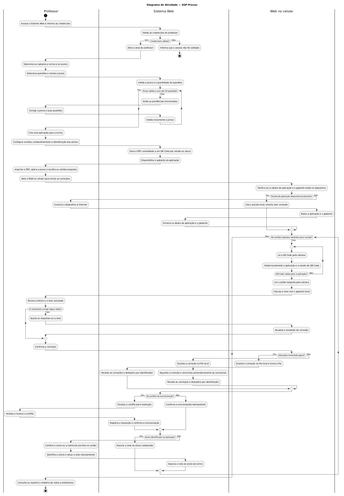

# Diagrama de Atividade do SGP

Este documento segue o formato do exemplo FastBurger dado em aula: primeiro a
análise do [Cenário Base](../README.md#cenário-base), depois o diagrama pronto.

## 2. Diagrama de Atividades

O diagrama de atividade descreve o fluxo completo de uma prova no SGP-Provas, desde o login do professor até a consulta do relatório de notas. Ele mostra **quem faz o quê** (raias) e **em que ordem** (fluxo), incluindo decisões, repetições e o funcionamento offline da correção.

### Passo 2A: Análise do Fluxo Cronológico

1. **Início e login.** O fluxo começa na raia *Professor*, que informa as credenciais. O *Sistema Web* as valida.
2. **Decisão: credenciais válidas?** Se **sim**, abre a área do professor. Se **não**, informa que o acesso não foi validado e o fluxo **termina**.
3. **Preparação da prova.** O professor seleciona ou cadastra a turma e os alunos, depois seleciona questões e monta a prova.
4. **Laço de validação da prova.** O sistema valida a prova e a quantidade de questões. Enquanto a prova **não** for válida ou tiver mais de 20 questões, ele exibe as pendências, o professor corrige e o sistema valida de novo. Quando for válida (**sim**), o fluxo segue.
5. **Criação da aplicação.** O professor cria uma aplicação para a turma e configura versões, embaralhamento e identificação dos alunos.
6. **Geração de materiais.** O sistema gera o PDF consolidado e um QR Code por versão ou aluno, e disponibiliza o gabarito.
7. **Aplicação presencial.** O professor imprime o PDF, aplica a prova, recolhe os cartões-resposta e abre o **Web no celular** para corrigir.
8. **Decisão: pacote disponível localmente?** O *Web no celular* verifica se a aplicação e o gabarito estão no dispositivo. Se **sim**, usa o pacote local, mesmo sem conexão. Se **não**, o professor conecta à Internet, o celular baixa a aplicação e o gabarito e o *Sistema Web* os fornece.
9. **Laço principal de correção** (repete enquanto houver cartões restantes):
   1. **Laço de QR Code:** lê o QR Code pela câmera e valida localmente a aplicação e a versão. Repete enquanto o QR Code **não** for válido.
   2. Lê o cartão-resposta pela câmera e calcula a nota com o gabarito local.
   3. O professor revisa a leitura e a nota.
   4. **Decisão: é necessário corrigir algum dado?** Se **sim**, o professor ajusta e o celular atualiza o resultado. Depois, o professor confirma a correção.
   5. **Decisão: aplicação conectada agora?** Se **sim**, guarda na fila local e envia a fila. Se **não**, guarda na fila local e sincroniza automaticamente ao reconectar. Nos dois casos o *Sistema Web* recebe as correções e deduplica por identificador.
   6. **Decisão: há conflito de sincronização?** Se **sim**, o sistema sinaliza, o professor resolve e o sistema registra a resolução. Se **não**, confirma a sincronização idempotente.
   7. **Decisão: aluno identificado na aplicação?** Se **sim**, associa a nota ao aluno cadastrado. Se **não**, o professor confere nome ou matrícula no cartão, lança a nota manualmente e o sistema a associa ao aluno da turma.
10. **Fim da correção.** Quando não restarem cartões, o professor consulta ou exporta o relatório de notas e estatísticas e o fluxo **termina**.

### Raias identificadas

| Raia | Papel |
|---|---|
| **Professor** | Ator humano: monta a prova, aplica, revisa e confirma as correções. |
| **Sistema Web** | Valida dados, gera o PDF e os QR Codes, fornece o gabarito, recebe e consolida as correções. |
| **Web no celular** | O sistema aberto no navegador do celular: lê QR Code e cartão pela câmera, calcula a nota localmente e sincroniza. |

O fluxo tem mais de um responsável, por isso usamos raias: cada coluna mostra quem
executa cada ação. A raia *Web no celular* não é um segundo sistema, é a mesma web
do SGP aberta no navegador do celular por causa da câmera
([ADR-001](../../adr/ADR-001-web-responsiva-no-lugar-de-app-nativo.md)). O aluno
não tem raia, porque não executa nenhuma ação no sistema.

### Elementos UML usados

- **Raias (swimlanes):** `|Professor|`, `|Sistema Web|`, `|Web no celular|`
- **Nó inicial e finais:** `start` / `stop` (há um final antecipado no login inválido)
- **Decisões:** `if / else`
- **Laços:** `while` (validação da prova e correção) e `repeat while` (leitura do QR Code)

### Diagrama de Atividades

Código-fonte: [`atividade.puml`](atividade.puml)
