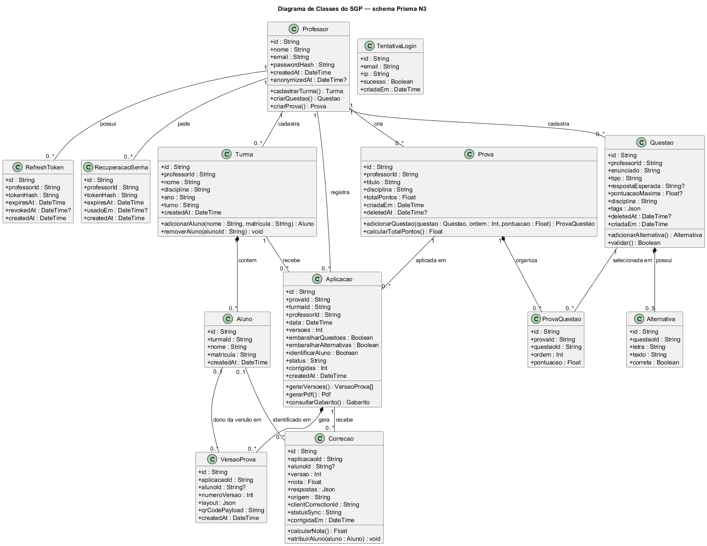

## 3. Diagrama de Classes

Esta versão alinha as classes, atributos, tipos e multiplicidades ao schema final em `apps/api/prisma/schema.prisma`. Os tipos seguem os escalares Prisma; o campo `data`, por exemplo, é `DateTime` com armazenamento MySQL `Date`. Atributos com `?` aceitam nulo. As multiplicidades refletem a nulabilidade das FKs e as relações declaradas no schema; o limite de 0 a 5 alternativas por questão vem da regra de negócio validada pela API.

### Passo 3A: Extração do Texto ("Truque do Detetive")

#### Identificando as classes (substantivos)

Partindo dos substantivos do cenário base, identificamos as classes abaixo. Os nomes
e atributos seguem o schema final da API: valores numéricos são `Float` (no lugar do
`Decimal` planejado na Parte 1) e as tags da questão são guardadas como `Json`.
`Aluno` guarda só nome e matrícula (além do id, da turma e da data de cadastro),
conforme a regra de escopo.

| Classe | Descrição |
|---|---|
| Professor | Usuário que acessa o sistema, cadastra turmas, questões e provas. |
| RefreshToken | Sessão de login do professor: guarda só o hash do refresh token, a validade e a revogação. |
| RecuperacaoSenha | Pedido de "Esqueci minha senha": guarda só o hash do token, a validade de 1 hora e quando foi usado (uso único). |
| TentativaLogin | Registro de cada tentativa de login (e-mail, IP e resultado), usado para limitar tentativas; não tem relação com as demais classes. |
| Turma | Grupo de alunos de uma disciplina, ano e turno, pertencente a um professor. |
| Aluno | Registro de nome e matrícula dentro de uma turma; não tem acesso ao sistema. |
| Questao | Questão objetiva ou discursiva do banco do professor, com tags em `Json` e exclusão lógica (`deletedAt`). |
| Alternativa | Opção de resposta de uma questão objetiva, marcada como correta ou incorreta. |
| Prova | Modelo reutilizável com título, disciplina, questões selecionadas e total de pontos (`Float`). |
| ProvaQuestao | Associação entre prova e questão, que guarda a ordem e a pontuação (`Float`) naquela prova. |
| Aplicacao | Preparação da prova para uma turma, com data, configuração de versões, status e provas corrigidas. |
| VersaoProva | Uma versão gerada para uma aplicação, com o layout embaralhado e o conteúdo do QR Code; na prova identificada, também o aluno dono da versão. |
| Correcao | Resultado da leitura ou do lançamento manual de uma prova respondida, com a nota (`Float`). |

#### Interpretando associações e multiplicidades

A pergunta-chave é: **“Quantos desse podem estar ligados a aquele?”**

- **Professor e RefreshToken:** 1 professor tem 0..* refresh tokens (um por sessão aberta); cada token pertence a 1 professor.
- **Professor e RecuperacaoSenha:** 1 professor tem 0..* pedidos de redefinição de senha; cada pedido é de 1 professor. Um pedido só vale uma vez e por 1 hora.
- **Professor e Turma:** 1 professor tem 0..* turmas; cada turma é de 1 professor.
- **Professor e Questao:** 1 professor cadastra 0..* questões; cada questão pertence a 1 professor.
- **Professor e Prova:** 1 professor cria 0..* provas; cada prova pertence a 1 professor.
- **Professor e Aplicacao:** 1 professor registra 0..* aplicações; cada aplicação pertence a 1 professor.
- **Turma e Aluno:** composição, 1 turma contém 0..* alunos; cada aluno pertence a 1 turma e deixa de existir no sistema quando removido da turma.
- **Questao e Alternativa:** composição, 1 questão tem 0..5 alternativas; cada alternativa pertence a 1 questão. Questões objetivas têm de 2 a 5 alternativas; discursivas não têm alternativas.
- **Prova e Questao:** muitos para muitos, resolvido pela classe `ProvaQuestao`, que guarda ordem e pontuação; uma prova tem até 20 questões. A ligação de `Prova` com `ProvaQuestao` é composição: cada registro de associação aponta para 1 prova e 1 questão.
- **Prova e Aplicacao:** 1 prova pode estar em 0..* aplicações; cada aplicação usa 1 prova.
- **Turma e Aplicacao:** 1 turma pode receber 0..* aplicações; cada aplicação é destinada a 1 turma.
- **Aplicacao e VersaoProva:** composição, 1 aplicação gera 0..* versões; cada versão pertence a 1 aplicação. A aplicação nasce como rascunho, sem versões, e as versões são criadas quando o PDF é gerado.
- **Aluno e VersaoProva:** cada versão pode estar ligada a 0..1 aluno; um aluno pode ter 0..* versões (no máximo uma por aplicação). A ligação só é preenchida quando a aplicação é identificada: o sistema gera uma versão por aluno da turma, e o QR Code e o cartão-resposta levam o nome e a matrícula. Se o aluno é apagado, a versão fica sem aluno.
- **Aplicacao e Correcao:** 1 aplicação tem 0..* correções; cada correção pertence a 1 aplicação.
- **Correcao e Aluno:** cada correção pode estar ligada a 0..1 aluno; um aluno pode ter 0..* correções. A associação fica vazia quando a prova não foi identificada e é preenchida no lançamento manual.

### O que mudou em relação à Parte 1

- Incluída a classe `RefreshToken`, que registra tokens vinculados ao professor.
- Alinhados os tipos numéricos `Decimal` para `Float` e `String[]` para `Json`, conforme o Prisma.
- Corrigidos atributos que não existem no banco: `totalProvas`, `pdfUrl`, `versaoProva`, dados de identificação informados, códigos públicos e campos de publicação de gabarito.
- Incluídos campos que faltavam no diagrama, como `createdAt`, `criadaEm`, `deletedAt`, `corrigidas`, `qrCodePayload` e `clientCorrectionId`.
- `clientCorrectionId` agora é obrigatório e único no schema. `alunoId` continua opcional para correções sem aluno identificado.
- As relações mantêm as FKs do schema: uma correção referencia uma aplicação e, opcionalmente, um aluno; `VersaoProva` pertence à aplicação, sem FK direta de correção para versão.
- A associação `Aplicacao` e `VersaoProva` passou de `1..*` para `0..*`, porque a aplicação existe sem versões até o PDF ser gerado. `Questao` e `Alternativa` continua `0..5`, o limite validado pela API.
- Os métodos de domínio da Parte 1 foram mantidos, com `Float` no lugar de `Decimal` (por exemplo, `Prova.calcularTotalPontos() : Float` e `Correcao.calcularNota() : Float`), assim como as composições de `Turma` e `Aluno`, `Questao` e `Alternativa`, `Prova` e `ProvaQuestao`, e `Aplicacao` e `VersaoProva`.

### O que mudou na N3

- `VersaoProva` ganhou `alunoId` (opcional), para a prova identificada.
- Incluídas as classes `TentativaLogin` (limite de tentativas de login) e `RecuperacaoSenha` (redefinição de senha por link de uso único).
- `Aplicacao` ganhou as operações `gerarPdf()` e `consultarGabarito()`, que correspondem às rotas `GET /applications/:id/pdf` e `GET /applications/:id/answer-key`.
- O campo `status` da aplicação passa a ser calculado: vira "concluída" quando todos os alunos distintos da turma têm correção.

### Diagrama de Classes

