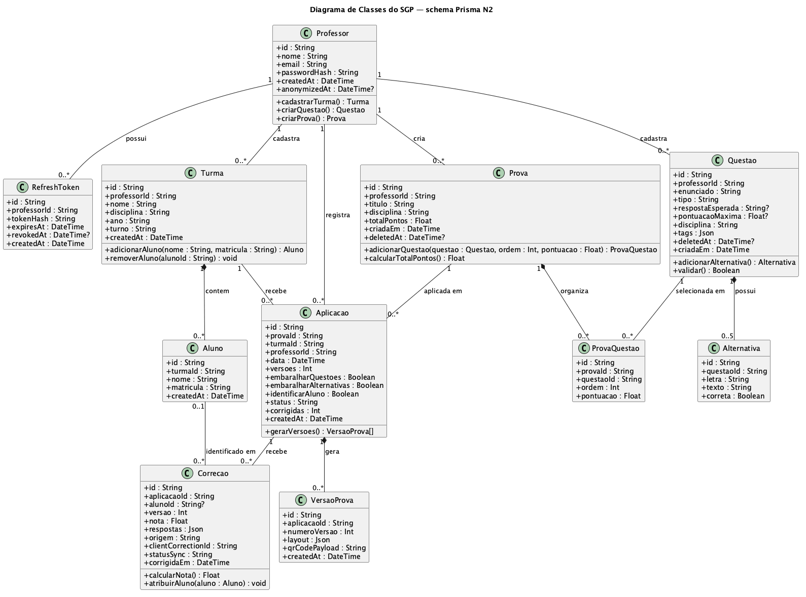

# Diagrama de Classes

Esta versão alinha as classes, atributos, tipos e multiplicidades ao schema final em `apps/api/prisma/schema.prisma`. Os tipos seguem os escalares Prisma; o campo `data`, por exemplo, é `DateTime` com armazenamento MySQL `Date`. Atributos com `?` aceitam nulo. As multiplicidades refletem a nulabilidade das FKs e as relações declaradas no schema; limites de negócio como a quantidade de alternativas são tratados pela API.

## O que mudou em relação à Parte 1

- Incluída a classe `RefreshToken`, que registra tokens vinculados ao professor.
- Alinhados os tipos numéricos `Decimal` para `Float` e `String[]` para `Json`, conforme o Prisma.
- Corrigidos atributos que não existem no banco: `totalProvas`, `pdfUrl`, `versaoProva`, dados de identificação informados, códigos públicos e campos de publicação de gabarito.
- Incluídos campos que faltavam no diagrama, como `createdAt`, `criadaEm`, `deletedAt`, `corrigidas`, `qrCodePayload` e `clientCorrectionId`.
- `clientCorrectionId` agora é obrigatório e único no schema. `alunoId` continua opcional para correções sem aluno identificado.
- As relações mantêm as FKs do schema: uma correção referencia uma aplicação e, opcionalmente, um aluno; `VersaoProva` pertence à aplicação, sem FK direta de correção para versão.
- As associações `Aplicacao`–`VersaoProva` e `Questao`–`Alternativa` passaram a `0..*`, pois o banco não declara mínimo de registros. Os limites funcionais são validados pela API.

## Diagrama

