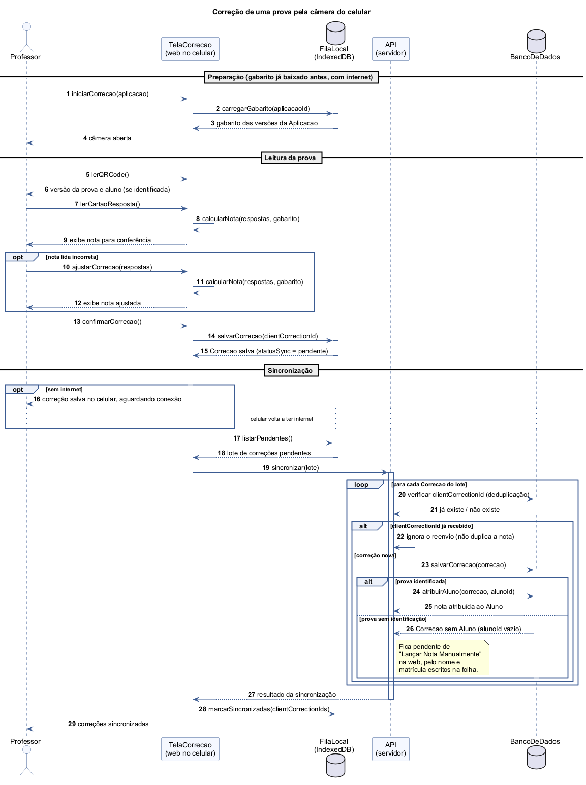

# Diagrama de Sequência do SGP

Este documento segue o formato do exemplo FastBurger dado em aula: primeiro a
análise do [Cenário Base](../README.md#cenário-base), depois o diagrama pronto.

## 4. Diagrama de Sequência

O diagrama de sequência mostra **a ordem no tempo** das mensagens trocadas entre
quem participa de um cenário. Escolhemos o cenário que é o coração do SGP:

> **Correção de uma prova pela câmera do celular.** Depois da prova em sala, o
> Professor abre a tela de correção da web no navegador do celular
> (`/correcao`), lê o QR Code e o cartão-resposta, confere a nota calculada e
> confirma. Isso funciona com ou sem internet, e com prova identificada ou não.

Trecho do cenário base que originou o diagrama: *"o Professor abre o SGP no
navegador do celular, que já baixou o gabarito e funciona sem internet, lê o QR
Code e o cartão-resposta de cada prova pela câmera, confere a nota calculada
automaticamente e confirma. Se a prova era identificada, a nota vai direto para
o aluno; se não, o Professor lança a nota manualmente na web depois [...]. Quando
o celular volta a ter internet, as correções são sincronizadas."* (RF08, RF09,
RF10).

### Passo 4A: Como Analisar e Ler o Diagrama

#### 1. Atores e objetos (quem participa)

No topo do diagrama ficam os participantes, da esquerda para a direita na ordem
em que entram na conversa:

| Participante | Símbolo | Papel no cenário |
|---|---|---|
| Professor | ator (boneco) | Único usuário do SGP. Aponta a câmera, confere a nota e confirma a correção. |
| TelaCorrecao | objeto (retângulo) | A tela `/correcao` da própria web, aberta no navegador do celular. Lê o QR Code e o cartão-resposta e calcula a nota. Não é um app separado (ver [ADR-001](../../adr/ADR-001-web-responsiva-no-lugar-de-app-nativo.md)). |
| FilaLocal | banco de dados (cilindro) | Armazenamento do navegador (IndexedDB). Guarda o gabarito baixado antes e a fila de correções que ainda não foram enviadas. |
| API | objeto (retângulo) | Servidor do SGP. Recebe as correções, evita duplicidade e atribui a nota ao aluno. |
| BancoDeDados | banco de dados (cilindro) | Onde ficam gravadas a `Correcao`, a `Aplicacao` e o `Aluno` (mesmas classes do Diagrama de Classe). |

**Por que o Aluno não é participante:** o aluno não troca nenhuma mensagem com o
sistema. Ele respondeu a prova no papel, fora do SGP. No diagrama ele aparece só
como **dado**: o `alunoId` que vem no QR Code da prova identificada e a classe
`Aluno` à qual a nota é atribuída.

#### 2. Linhas de vida (o tempo passando)

De cada participante desce uma **linha tracejada vertical**, a linha de vida. O
tempo corre **de cima para baixo**: a mensagem 1 acontece antes da 2, e assim por
diante (por isso usamos numeração automática).

Os **retângulos finos** sobre as linhas de vida são as **barras de ativação**:
mostram quando o participante está trabalhando. A TelaCorrecao fica ativa do
início ao fim, porque conduz toda a correção. A API só é ativada quando chega a
sincronização (mensagem 19), o que deixa claro que **ler e corrigir a prova não
depende do servidor**.

O diagrama é dividido em três fases, marcadas com faixas horizontais:

1. **Preparação:** a tela carrega da FilaLocal o gabarito, que já foi baixado
   antes, quando havia internet (mensagens 1 a 4).
2. **Leitura da prova:** QR Code, cartão-resposta, cálculo e conferência da nota,
   até a correção ficar salva no celular (mensagens 5 a 15).
3. **Sincronização:** envio da fila para a API e gravação no banco (mensagens 16
   a 29).

#### 3. Mensagens contínuas e tracejadas

- **Seta contínua (→):** uma chamada, um pedido para alguém fazer algo. Ex.:
  `lerCartaoResposta()`, `salvarCorrecao(clientCorrectionId)`,
  `sincronizar(lote)`.
- **Seta tracejada (⇠):** o retorno, a resposta a um pedido anterior. Ex.:
  "exibe nota para conferência", "resultado da sincronização".
- **Seta que volta para o próprio participante:** processamento interno. A
  TelaCorrecao faz `calcularNota(respostas, gabarito)` sozinha, sem falar com o
  servidor. É isso que permite corrigir sem internet.

A sequência principal das mensagens:

| # | De → Para | Mensagem | O que significa |
|---|---|---|---|
| 1 | Professor → TelaCorrecao | `iniciarCorrecao(aplicacao)` | Professor escolhe a aplicação a corrigir. |
| 2–3 | TelaCorrecao → FilaLocal | `carregarGabarito(aplicacaoId)` | Gabarito de todas as versões, já baixado antes. |
| 5–6 | Professor → TelaCorrecao | `lerQRCode()` | Descobre a versão da prova e, se identificada, o aluno. |
| 7 | Professor → TelaCorrecao | `lerCartaoResposta()` | Lê as alternativas marcadas. |
| 8 | TelaCorrecao → TelaCorrecao | `calcularNota(respostas, gabarito)` | Compara com o gabarito da versão lida. |
| 9 | TelaCorrecao → Professor (retorno) | exibe nota para conferência | Professor confere antes de confirmar. |
| 13 | Professor → TelaCorrecao | `confirmarCorrecao()` | Professor aprova a nota. |
| 14–15 | TelaCorrecao → FilaLocal | `salvarCorrecao(clientCorrectionId)` | Correção gravada no celular com `statusSync = pendente`. |
| 19 | TelaCorrecao → API | `sincronizar(lote)` | Envia todas as correções pendentes de uma vez. |
| 20–21 | API → BancoDeDados | verificar `clientCorrectionId` | Deduplicação: a mesma correção nunca é gravada duas vezes. |
| 23–26 | API → BancoDeDados | `salvarCorrecao` / `atribuirAluno` | Grava a `Correcao` e, se possível, liga a nota ao `Aluno`. |
| 28 | TelaCorrecao → FilaLocal | `marcarSincronizadas(...)` | Tira as correções da fila de pendentes. |

#### 4. Blocos de decisão (alt, opt e loop)

Os retângulos com rótulo no canto são **fragmentos combinados**. A condição fica
entre colchetes.

- **`opt [nota lida incorreta]`** (mensagens 10 a 12): opcional. Só acontece se
  a câmera leu alguma marcação errada; o Professor ajusta as respostas e a nota
  é recalculada antes de confirmar (RF08). Corresponde ao caso de uso
  "Ajustar Correção".

- **`opt [sem internet]`** (mensagem 16): opcional. Se o celular está sem
  conexão, a correção **já está salva na FilaLocal** (mensagem 15), então a
  tela só avisa o Professor que ela está aguardando conexão. A linha pontilhada
  "celular volta a ter internet" indica que **o tempo passa** (podem ser horas)
  até a sincronização continuar. Com internet, esse bloco é pulado e a
  sincronização acontece logo em seguida. Por isso a correção é **sempre** salva
  primeiro no celular: o fluxo é o mesmo com ou sem internet, muda só quando o
  envio acontece (RF10).

- **`loop [para cada Correcao do lote]`**: a API repete a verificação para cada
  correção enviada no lote.

- **`alt [clientCorrectionId já recebido] / [correção nova]`**: alternativa (só
  um dos lados acontece). O `clientCorrectionId` é um identificador criado no
  celular no momento em que a correção é salva. Se a internet cair no meio do
  envio, o celular manda o mesmo lote de novo; a API reconhece o id e **ignora o
  reenvio**, sem duplicar a nota. É o que torna a sincronização idempotente
  (RF10).

- **`alt [prova identificada] / [prova sem identificação]`** (dentro de
  "correção nova"), que é a decisão central do RF09:
  - **Prova identificada:** o QR Code já trazia o aluno, então a API faz
    `atribuirAluno(correcao, alunoId)` e **a nota vai direto para o aluno**,
    sem nenhuma ação extra do Professor.
  - **Prova sem identificação:** a `Correcao` é gravada **sem aluno** (`alunoId`
    vazio) e fica **pendente de lançamento manual**. Depois, na web, o Professor
    usa o caso de uso "Lançar Nota Manualmente", identificando o aluno pelo nome
    e pela matrícula escritos à mão na folha.

### Diagrama de Sequência

Código-fonte do diagrama: [sequencia.puml](sequencia.puml) (PlantUML).
